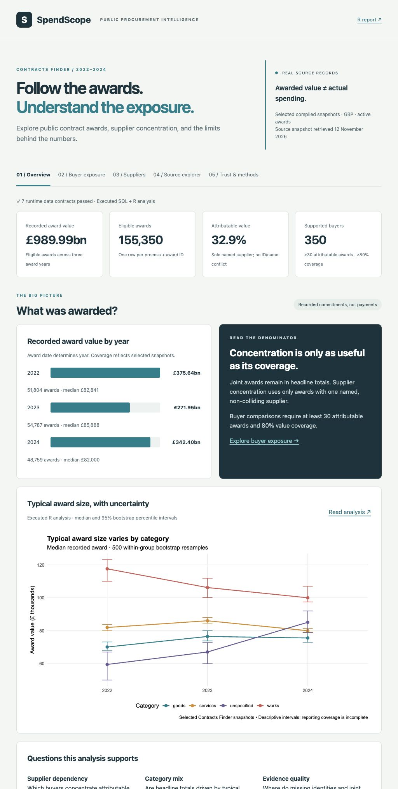

# SpendScope

**Public procurement analytics with SQL, Python and R: follow the evidence behind supplier concentration.**

[Live dashboard](https://maxliston.github.io/spendscope-procurement-analytics/) · [R research note](https://maxliston.github.io/spendscope-procurement-analytics/research.html) · [Business case studies](EXECUTIVE_MEMO.md)

[](https://github.com/MaxListon/spendscope-procurement-analytics/actions/workflows/checks.yml)



A procurement manager wants to know where award commitments are concentrated. Raw data contains joint awards, revision history, placeholder suppliers and inconsistent identifiers. SpendScope separates accounting grain from identity evidence so those problems stay visible instead of becoming confident rankings.

## What makes the analysis useful

- **Real, pinned data:** three UK Contracts Finder process-snapshot files compiled by the Open Contracting Partnership; 219,121 processes and 155,350 eligible awards. Fingerprints fail closed if a source changes.
- **Substantial SQL:** independent award/supplier grains, reconciliation contracts, HHI and supplier shares, coverage gates, registration-evidence sensitivity, and nine comparison-threshold scenarios.
- **Python engineering:** conservative identity rules, documented exact alias approvals, source-notice evidence checks, single-writer locking, staged computation, corruption/staleness verification and clean-release packaging.
- **Random validation:** a frozen 40-identity sample from 11,517 previously unreviewed registrations; registry-name evidence, uncertainty intervals, nonresponse bounds and conflict holdbacks. This is not precision/recall of all supplier matching.
- **Executed R research:** 500 procurement-process bootstrap resamples per category-year; 300 per supported buyer case; independent-award comparison intervals, removal/capping sensitivity, an independent SQL/R HHI check, buyer-clustered median alternatives and calendar-quarter HHI sensitivity.
- **Evidence review:** 31 normalized-name/registration cases across five Companies House records; 11 approvals, two rejections and 18 unresolved cases. Twenty large award records selected for notice review; 20 pages observed and 11 attribution holdbacks. This targeted review is not a population accuracy estimate or an independent audit.
- **A meaningful finding:** attachment-list instructions and generic labels had been treated as suppliers. The upgraded rules exclude placeholders and invalid registration formats from supplier attribution while preserving eligible award totals. Read the generated business cases for the measured impact.
- **A usable dashboard:** buyer/supplier search, registration-evidence filter, downloadable results, original notice links, evidence register, R research note and clear caveats.

## Run from a clean checkout

Requirements: Python 3.12+ and R 4.5.3. Internet is needed for the first download and dependency installation. Run from the source checkout; SQL and R files are required at runtime.

```sh
python3 -m venv .venv
source .venv/bin/activate
pip install -r requirements-lock.txt
pip install -e '.[dev]'
mkdir -p .Rlibrary
export R_LIBS_USER="$PWD/.Rlibrary"
Rscript -e 'install.packages(c("ggplot2", "jsonlite", "svglite"), repos="https://cloud.r-project.org")'
python -m spendscope.pipeline --root .
pytest -q
Rscript R/test_concentration.R
python scripts/verify.py
python -m http.server 8080 --directory docs
```

Open http://localhost:8080. Raw archives total about 135 MB compressed; allow several GB of memory and several minutes for a full build. Rebuild the pinned cache without network using `python -m spendscope.pipeline --root . --offline`.

Python dependencies are pinned in `requirements-lock.txt`; executed R versions are recorded in `reports/r_environment.csv`. R package installation follows the configured repository and records resolved versions; no complete transitive R lockfile is claimed.

## Read it responsibly

**Recorded award value is not actual payments, annual expenditure or realized supplier revenue.** Framework ceilings, overlapping commitments, missing reporting and publication changes can dominate sums.

Default buyer support requires at least 30 attributable awards and 80% eligible-value coverage. Registration evidence is displayed separately. Non-colliding published registrations are format-checked, not all independently verified. Name-only identities remain provisional. A published buyer ID/name pair is not necessarily a fully resolved organization.

The process bootstrap keeps awards linked by the same OCID together. Broader buyer/quarter alternatives test dependence across processes, while a declared-link audit refuses to infer missing relationships. None identifies all related call-offs or repairs missing data. No causal effect, misconduct, procurement savings or live operational deployment is claimed.

## Inspect the work

| Artifact | Purpose |
|---|---|
| [Methodology](METHODOLOGY.md) | Grain, identity evidence, denominators, statistical assumptions |
| [Data dictionary](DATA_DICTIONARY.md) | Reporting field definitions |
| [Executive memo](EXECUTIVE_MEMO.md) | Measured findings and business interpretation |
| [Evidence decisions](data/review/) | Versioned notice checks and exact identity decisions |
| [R analysis](R/) | Process bootstrap, cross-checks and regression cases |
| [SQL marts](sql/marts.sql) | Reviewable business logic |
| [Random registry audit](RANDOM_AUDIT.md) | Sampling frame, evidence outcomes and uncertainty |
| [Reviewer packet](REVIEWER_GUIDE.md) | Tasks and acceptance criteria for an actual outside reviewer |
| [Verification](VERIFICATION.md) | Completed checks and remaining review |
| [Runbook](RUNBOOK.md) | Rebuild, failure recovery, CI and gated deployment |
| [Development roadmap](PROJECT_PLAN.md) | Proposed multi-month validation schedule, not elapsed work |
| [Interview guide](INTERVIEW_GUIDE.md) | Explain the decisions and their limits |

## Source and license

[UK Contracts Finder, compiled by Open Contracting Partnership](https://data.open-contracting.org/en/publication/128). Contains public sector information licensed under the [Open Government Licence v3.0](https://www.nationalarchives.gov.uk/doc/open-government-licence/version/3/). Registration evidence links to [Companies House](https://find-and-update.company-information.service.gov.uk/). Original data publishers retain source authorship. Code: MIT. Maintainer: MaxListon.
